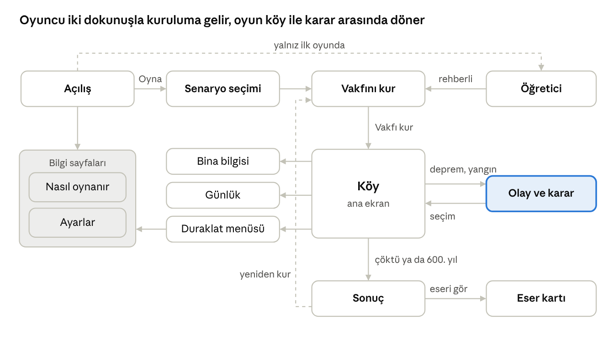

# Vakıf Oyunu · Sayfa sayfa içerik ve akış

20 Ekim 2026 (durumlar 21 Ekim'de güncellendi) · Rabia Altundal · Canlı belge: claude.ai'deki "Vakıf Oyunu · Sayfa sayfa içerik ve akış" dokümanı (bu dosya onun kopyasıdır)

Oyun 13 sayfadan oluşur: 4'ü oyundan önce, 5'i oyun sırasında, 4'ü oyundan sonra ve bilgi için. Aynı tasarım hem telefonda (uygulama) hem tarayıcıda (web) çalışır; kurallar ve sayılar [vakif-oyunu-kurallari-v2.md](vakif-oyunu-kurallari-v2.md) ile aynıdır.

## Sayfa listesi

Oyuncu en fazla 3 dokunuşla oyuna girer: Açılış → Senaryo → Kurulum. Öğretici yalnızca ilk açılışta kendiliğinden başlar.

| # | Sayfa | Ne zaman açılır | Oyuncuya ne kazandırır | Durum |
| --- | --- | --- | --- | --- |
| 1 | Açılış (ana menü) | Uygulama açılınca | Oyuna gir, nasıl oynanır, ayarlar | Kodda var |
| 2 | Öğretici | İlk oyunda kendiliğinden, sonra menüden | 3 dakikada oyunu oynayarak öğrenir | Kodda var |
| 3 | Senaryo seçimi | "Oyna"ya basınca | Serbest vakıf ya da gerçek bir Bursa vakfı | Tasarımda var |
| 4 | Vakfını kur | Senaryodan sonra | Dört kurulum kararı: sermaye, amaç, yedek fon, mütevelli | Kodda var |
| 5 | Köy | "Vakfı kur"dan sonra | Zamanın akmasını, paranın nereden gelip nereye gittiğini izler | Kodda var |
| 6 | Bina bilgisi | Köyde bir binaya dokununca | O binanın ne kazandırdığını, neye dayandığını görür | Kodda var |
| 7 | Olay ve karar | Deprem ya da yangında, oyun durur | Hasarı fonla, nakitle ya da hizmeti kısarak karşılar | Kodda var |
| 8 | Günlük | Sol kenardaki düğmeyle | Geçmiş her turun olayını okur | Kodda var |
| 9 | Duraklat menüsü | Sağ üstteki düğmeyle | Devam, yeniden kur, kurallar, ayarlar, çıkış | Kodda var |
| 10 | Sonuç | Vakıf çökünce ya da 600. yıla varınca | Kaç yıl yaşadı, en iyi kararı, çıkan ders | Kodda var |
| 11 | Eser kartı | Sonuçtaki "Gerçek eseri gör" ya da bina bilgisinden | Oyundaki yapının Bursa'daki gerçeği: fotoğraf, tarih, konum | Tasarımda var |
| 12 | Nasıl oynanır | Menüden ya da duraklatmadan | Kurallar ve kavramlar sözlüğü, iki sekme | Kodda var |
| 13 | Ayarlar | Menüden ya da duraklatmadan | Ses, hız, yazı boyutu, erişilebilirlik, dil | Kodda var |

## Ekran akışı

Oyun Köy ile Olay ve karar arasında döner; bina bilgisi, günlük ve duraklat menüsü köyün üstüne açılır. Kesikli çizgiler yalnızca bazen izlenen yollar: ilk oyundaki öğretici ve sonuçtan yeniden kurulum.

Koddaki ekranların bugünkü hali: [ana menü](img/ekran-1-menu.png) · [kurulum ve öğretici](img/ekran-2-kurulum-ogretici.png) · [köy ve tur şeridi](img/ekran-3-koy-tur-seridi.png) · [karar](img/ekran-4-karar.png) · [sonuç](img/ekran-5-sonuc.png) · [ayarlar](img/ekran-6-ayarlar.png) · [nasıl oynanır](img/ekran-7-nasil-oynanir.png) · [duraklat](img/ekran-8-duraklat.png)

## Oyunun kuralları

Oyuncuya anlatılacak metin aşağıda, oyunda da bu sırayla ve bu dille geçer. Her madde "Nasıl oynanır" sayfasında bir kart olur.

1. **Amacın:** Bir vakıf kur ve 600 yıl ayakta tut. Vakfın bir hizmeti var (aşevi, medrese ya da çeşme); bu hizmet hiç aksamamalı.
2. **Kurulum, bir kez:** 100 birim sermayeyi hamam, han, arazi ve nakit arasında paylaştırırsın. Hizmeti, yedek fon şartını ve mütevelliyi seçersin. Bunlar oyun boyunca değişmez.
3. **Zaman akar:** Her tur 10 yıldır. "+10 yıl" bir tur oynatır; "İlerle" bir karar anına kadar turları kendiliğinden çevirir.
4. **Para her tur aynı yolu izler:** Mülkler gelir getirir → şartın kadarı yedek fona ayrılır → binaların bakımı ödenir → kalan para hizmete gider. Artan para birikmez; birikim yalnızca yedek fonda olur.
5. **Hizmet ödenemezse:** Eksik yedek fondan karşılanır. Fon da yetmezse sandık boş kalır. **Üç tur üst üste** sandık boş kalırsa vakıf çöker.
6. **Olaylar:** Her tur bir olay çıkabilir (yüzde 36). Kuraklık araziyi, savaş hanı o tur gelirsiz bırakır; enflasyon nakdi ve fonu eritir, hizmetin gideri kalıcı artar. Bunlarda karar sorulmaz.
7. **Deprem ve yangın karar ister:** Deprem hamamın %80'ini, hanın %40'ını; yangın hanın %60'ını yıkar. Oyun durur ve üç yol sunar:
    - **Yedek fonla onar:** Her şey eski hâline döner, ama fon azalır. Fon yetmiyorsa bu seçenek kapalıdır.
    - **Nakitle onar:** Nakit yettiği kadar onarır, kalanı kalıcı kaybedilir.
    - **Hizmeti kıs:** Para harcanmaz. Hasarın %85'i 4 turda geri gelir, kalanı kaybolur; 2 tur hizmet yarım verilir.
8. **Mütevelli:** Dürüst olan güvenlidir. Becerikli olan %5 fazla kazandırır ama her tur %15 ihtimalle fonun %60'ını zimmetine geçirebilir.
9. **Oyun biter:** 600. yıla ulaşırsan vakıf ayakta kalır. Sonuç sayfası sana en iyi kararını ve vakfının sana öğrettiği dersi gösterir.
10. **Aynı tohum, aynı tarih:** Aynı tohum numarasıyla oynarsan aynı olaylar aynı yıllarda gelir. Ayarları değiştirip aynı tarihi yeniden yaşayabilirsin.

Oyunun dört dersi kurulumdaki dört karardan çıkar: gelir kaynaklarını dağıt, yedek fon ayır, mütevelliyi dürüstlüğüne göre seç, hizmeti gelirin taşıyabileceği kadar büyük tut.

## Kavramlar sözlüğü

Oyuncunun bilmesi gereken 14 kavram var. Her biri ilk görüldüğü yerde altı noktalı çizgiyle işaretlenir; dokununca kısa açıklama açılır. Hepsi "Nasıl oynanır > Kavramlar" sekmesinde toplu durur.

| Kavram | Oyunda ne demek | Tarihte ne demek | İlk nerede görülür |
| --- | --- | --- | --- |
| Vakıf | Oyuncunun kurduğu, 600 yıl yaşatmaya çalıştığı kurum | Bir kişinin malını bir hayrın sürmesi için süresiz olarak ayırması ve bunu yürüten kurum | Açılış |
| Vakfiye | Kurulum ekranının kendisi: dört kararın yazıldığı belge | Vakfın kuruluş senedi; malları, hizmeti ve şartları yazar | Vakfını kur |
| Akar | Gelir getiren mülkler: hamam, han, arazi | Kirası ya da ürünü vakfı besleyen mülkler | Vakfını kur |
| Hayrat | Vakfın hizmet binası: aşevi, medrese ya da çeşme | Halka ücretsiz hizmet veren yapılar | Vakfını kur, Amaç sekmesi |
| Şart | Gelirin ne kadarının yedek fona ayrılacağı | Vakfiyede vakfı kuranın koyduğu bağlayıcı kurallar | Yedek fon sekmesi |
| Yedek fon | Tek birikim; açıkları ve onarımları karşılar | Vakıfların onarım ve kötü günler için ayırdığı pay | Yedek fon sekmesi |
| Mütevelli | Vakfı yöneten kişi; dürüst ya da becerikli | Vakfı vakfiyeye göre yönetmekle görevli kişi | Mütevelli sekmesi |
| Zimmet | Becerikli mütevellinin fondan para alması | Kamu ya da vakıf malının görevlice kendine geçirilmesi | Köy, ilk zimmet olayında |
| Hamam | En çok kazandıran, depremde en çok yıkılan mülk | Vakıfların en yaygın gelir kaynaklarından biri | Vakfını kur |
| Han | Kervan ve çarşı geliri; yangın ve savaşa açık | Kervanların konakladığı, tüccarın ticaret yaptığı yapı | Vakfını kur |
| Aşevi (imaret) | En pahalı hizmet: tur başına 26 | Yoksullara ve yolculara yemek dağıtan yapı | Amaç sekmesi |
| Sandık | Gelirin toplandığı yer; "sandık boş" = hizmet verilemedi | Vakfın kasası | Köy |
| Onarım bedeli | Hasarın 0,9 katı | — (oyun kuralı) | Olay ve karar |
| Tohum | Olayların sırasını belirleyen sayı; aynı tohum aynı tarihi verir | — (oyun kuralı) | Vakfını kur, en altta |

## Öğretici (ilk oyun)

Öğretici ayrı bir sayfa değil, gerçek oyunun üstüne binen 8 adımlık bir rehberdir ve yaklaşık 3 dakika sürer. Tohum 10 sabittir, böylece ilk deprem her zaman 40. yılda gelir ve fon onarıma yeter. Her adımda ekranın geri kalanı kararmalı, yalnızca anlatılan yer parlamalı; oyuncu istediği an "Atla" diyebilmeli.

| Adım | Parlayan yer | Mütevellinin sözü | Oyuncu ne yapar |
| --- | --- | --- | --- |
| 1 | Köyün tamamı | "Hoş geldin. Bu köy senin vakfın olacak. Amacımız 600 yıl boyunca aşevini açık tutmak." | "Başlayalım"a basar |
| 2 | Sermaye kartları | "Elinde 100 birim var. Hamam çok kazandırır ama depremde yıkılır; arazi az kazandırır ama hiç yıkılmaz." | Hazır dağılımı (30/30/25/15) onaylar |
| 3 | Yedek fon kaydırıcısı | "Gelirin bir kısmını kötü günler için ayıralım. Buna vakfiyedeki şart denir." | %20'de bırakır, "Vakfı kur"a basar |
| 4 | Para akışı etiketleri | "Bak: hamamdan, handan, araziden sandığa para geliyor. Sandıktan da aşevine gidiyor." | "+10 yıl"a bir kez basar |
| 5 | Yedek fon çubuğu | "Fon biraz doldu. Biriken tek para budur; artan para o tur harcanır." | "İlerle"ye basar |
| 6 | Karar penceresi | "Deprem! Hamam ve han yıkıldı. Fon yetiyor; onarmak en güvenlisi." | "Fonla onar"ı seçer |
| 7 | Hamam (bina bilgisi) | "Bir binaya dokunursan ne kazandırdığını ve neye dayandığını görürsün." | Hamama dokunur |
| 8 | İlerle düğmesi | "Artık vakıf senin. 600. yıla kadar ayakta tut." | Rehber kapanır, oyun sürer |

Öğretici "Ayarlar > Öğreticiyi yeniden başlat" ile ya da "Nasıl oynanır" sayfasındaki düğmeyle istenen zaman yeniden açılır.

## Oyun öncesi sayfalar

### 1 · Açılış (ana menü)

Oyuncu burada tek bir şey yapar: "Oyna"ya basar. Diğer her şey ikincil durur.

- **Arka plan:** Canlı köy sahnesi, kamera yavaşça döner; hamamın buharı, aşevinin dumanı tüter.
- **Ortada:** Vakfiye logosu ve altında tek satır: "Vakfını kur, yüzyıllara bırak."
- **Düğmeler:** Büyük yeşil OYNA; altında küçük NASIL OYNANIR ve AYARLAR.
- **Köşede:** Son oyunun özeti, varsa: "Son vakfın 340 yıl yaşadı · Tekrar dene".
- **İlk açılış:** OYNA doğrudan öğreticiyi başlatır.

### 3 · Senaryo seçimi

Oyuncu nasıl bir vakıfla başlayacağını seçer. Kart düzeni, Clash'teki harita seçimi gibi yatay kayar.

- **Serbest vakıf:** Her şeyi oyuncu seçer. Varsayılan kart, çerçevesi parlak.
- **Gerçek vakıf: Orhan Gazi Külliyesi (Bursa):** Sermaye, vakfın gerçek mülk türlerine göre önceden dolu gelir; oyuncu yalnızca fon ve mütevelliyi seçer. Kartta yapının fotoğrafı ve "1339" gibi kuruluş yılı durur (tarih veri setinden doğrulanacak).
- **Kilitli kartlar:** Başka Bursa vakıfları gri ve kilitli görünür; "Bir oyunu 600 yıla taşı, açılsın" yazar. Bu, oyuncuyu tekrar oynamaya ve envantere yönlendirir.
- **Her kartta:** Zorluk (1–3 kubbe), hizmet türü ve bir cümlelik hikaye.

### 4 · Vakfını kur

Dört karar dört sekmede verilir; oyuncu sekmeler arasında serbestçe gidip gelir. Bu sayfa kodda hazır, aşağıdakiler eksik olanlar.

- **Sermaye:** Dört kart, 5'er birim artır/azalt. Toplam 100 değilse "Vakfı kur" kapalı kalır ve "eksik" ya da "fazla" yazar. Eklenecek: kartın üstündeki 3B bina, birim arttıkça büyüsün.
- **Amaç:** Üç kart; her birinde gider ve "zorluk" göstergesi. Eklenecek: kısa tarihsel not (örneğin aşevinin ne işe yaradığı).
- **Yedek fon:** Kaydırıcı %0–%50. Altında canlı önizleme: "Olaysız bir turda fona ≈ 10,9 ayrılır."
- **Mütevelli:** İki portre kartı (G3). Becerikli kartında kırmızı uyarı şeridi: "Fonu bir gün boşaltabilir."
- **Alt satır:** Toplam, tur başına tahmini gelir, tohum kutusu ve VAKFI KUR.
- **Tavsiye düğmesi (yeni):** "Dengeli dağıt" — 30/30/25/15'e döner. Kaybolan oyuncu için tek dokunuşla güvenli başlangıç.

## Oyun içi sayfalar

### 5 · Köy

Oyunun ana ekranı. Sahne ortada, sayılar kenarlarda; oyuncu parmaklarının altında yalnızca iki büyük düğme bulur.

- **Sol üst:** Vakıf rozeti, adı ("Aşevi Vakfı") ve yıl çubuğu (120 / 600).
- **Sağ üst:** Üç kaynak çubuğu: gelir (altın), yedek fon (turkuaz), nakit (kurşun). Eklenecek: duraklat düğmesi.
- **Üst orta:** Uyarı hapları: "Sandık boş: 1 / 3" kırmızı, "Hizmet yarım: 2 tur" turkuaz.
- **Sol kenar:** Günlük ve para etiketleri düğmeleri.
- **Sol alt:** İLERLE (karara kadar) ve +10 YIL. **Sağ alt:** YENİDEN KUR.
- **Alt orta:** Son günlük satırı; kötü olaylar kırmızı.
- **Olay afişi:** Her olayda üstte 2 saniyelik kırmızı şerit ("120. yıl · Kuraklık"), sahnede olayın etkisi: sarsıntı, alev, kuruyan tarla, kapalı yol.

### 6 · Bina bilgisi

Bir binaya dokununca altta açılan küçük panel; oyun durmaz.

- Bina adı ve birim sayısı, üç çip: gelir, bakım, risk.
- Tek cümlelik açıklama (örnek: "En çok kazandıran bina, ama depremde ilk yıkılan da o.").
- Eklenecek: "Gerçek eseri gör" düğmesi, eser kartına gider.
- Sandığa dokununca fon, nakit ve şart; hayrata dokununca hizmetin gideri görünür.

### 7 · Olay ve karar

Oyunun kalbi. Oyun durur, köy kararır, ortada parşömen pencere açılır.

- **Başlık kurdelesi:** DEPREM! ya da ÇARŞIDA YANGIN!
- **Özet satırı:** "40. yıl · hamamdan 24, handan 12 birim yıkıldı."
- **Üç çip:** Onarım bedeli · Yedek fon · Nakit.
- **Üç seçenek kartı:** Her kartta ne olacağı sayıyla yazar ("Fon 44 → 11", "Yetmeyen kısım kalıcı kayıp: 20 birim"). Kapalı seçenek gri, altında nedeni: "Fon yetmiyor 17 / 32".
- **Mütevelli balonu:** Duruma göre değişen bir cümle; tavsiye vermez, seçeneği hatırlatır.
- **Klavye ve ekran okuyucu:** Pencere açılınca odak ilk açık seçeneğe gider.

### 8 · Günlük

Sol kenardan açılan parşömen liste; en yeni olay üstte. Her satır "yıl · olay" biçiminde; kötü olaylar kırmızı, onarımlar turkuaz. Eklenecek: olaya göre süzme (yalnızca kararlar).

### 9 · Duraklat menüsü (yeni)

Sağ üstteki düğmeyle açılır, oyunu durdurur.

- DEVAM ET (büyük, yeşil)
- Yeniden kur · Nasıl oynanır · Ayarlar · Ana menü
- Altta tohum numarası ve "Bu oyunun bağlantısını kopyala" (aynı tohumla arkadaşı da oynasın).

## Oyun sonrası ve bilgi sayfaları

### 10 · Sonuç

Oyuncu burada neyi iyi yaptığını ve vakfın ona ne öğrettiğini görür. Dersi kurulumdaki ve karar anlarındaki seçimleri belirler.

- **Kurdele:** VAKIF AYAKTA! (altın) ya da VAKIF ÇÖKTÜ (kırmızı). Altında "600 yıl boyunca aşevi kapanmadı" ya da "Vakfın 160 yıl yaşadı. Son darbe: Deprem".
- **Üç madalyon:** olay sayısı · karar sayısı · boş sandık sayısı.
- **Seni kurtaran karar / İyi kararın:** En çok birim koruyan karar ("40. yıl · Deprem · Yedek fonla onarım").
- **Ders:** Beş dersten biri, altın tırnak içinde.
- **Düğmeler:** YENİDEN KUR · PAYLAŞ · GERÇEK ESERİ GÖR.
- **Eklenecek — "Aynı tarihi başka kararla dene":** Aynı tohumla kuruluma döner, ayarlar korunur. Sunumdaki "hamamı 70 yap, çöktüğünü gör" anı bu düğmeye dayanır.

### 11 · Eser kartı

Oyunu gerçek miras envanterine bağlayan köprü; hackathonun "vakıf eserleri envanteri" amacı burada görünür.

- Yapının fotoğrafı (F1, lisans onayından sonra), adı, kuruluş yılı, ilçesi.
- Oyundaki karşılığı: "Oyunda hamam olarak oynadın. Gerçekte bu hamamın geliri … vakfını besliyordu."
- Haritada konumu ve "Yol tarifi al".
- Envanterdeki tam kaydına gider. (Veri setleri gelince doldurulacak.)

### 12 · Nasıl oynanır

Oyun dışında da okunabilen kurallar sayfası. İki sekme:

- **Kurallar:** "Oyunun kuralları" bölümündeki 10 madde, her biri resimli bir kart. Kart, ilgili ekranın küçük görüntüsünü taşır.
- **Kavramlar:** Sözlükteki 14 kavram, aranabilir liste.
- **Altta:** ÖĞRETİCİYİ BAŞLAT düğmesi.

### 13 · Ayarlar

Ayrıntılar aşağıdaki "Ayarlar" bölümünde. Sayfa parşömen panel, her ayar bir satır; değişiklik anında uygulanır ve cihazda saklanır.

## Ayarlar

On ayar yeterli; dördü erişilebilirlik için. Hepsi cihazda saklanır, hesap gerekmez.

| Ayar | Seçenekler | Varsayılan | Neden |
| --- | --- | --- | --- |
| Müzik | Açık / kapalı, ses düzeyi | Açık, %60 | Toplu yerlerde kapatılabilsin |
| Efekt sesleri | Açık / kapalı, ses düzeyi | Açık, %80 | Sikke, deprem, alkış sesleri ayrı kontrol edilsin |
| Oyun hızı | Yavaş / normal / hızlı ("İlerle" turları arası 300 / 150 / 60 ms) | Normal | Sunumda yavaş, tekrar oyunda hızlı |
| Para etiketleri | Açık / kapalı | Açık | Sahnedeki +24,0 gibi sayılar yeni oyuncuya yol gösterir |
| Titreşim (yalnız telefon) | Açık / kapalı | Açık | Deprem ve karar anında dokunsal uyarı |
| Yazı boyutu | Normal / büyük / çok büyük | Normal | Okuma kolaylığı |
| Yüksek kontrast | Açık / kapalı | Kapalı | Renk ayırt etmekte zorlananlar |
| Hareketi azalt | Açık / kapalı | Cihaz ayarını izler | Sarsıntı ve animasyonlar baş döndürmesin |
| Sesli anlatım | Açık / kapalı | Kapalı | Olaylar ve kararlar sesli okunur; görme engelli oyuncular |
| Dil | Türkçe / English | Cihaz dili | Yarışma iki dilli, jüri ve turistler için |

Ayarların altında üç işlem durur: Öğreticiyi yeniden başlat · Kilitli senaryoları sıfırla · Hakkında ve aydınlatma metni (KVKK).

## Web ve uygulama uyumu

Tek kod, tek tasarım; fark yalnızca ekran boyutuna ve giriş yöntemine göre yerleşimde. Oyun ekranları (5–10) yatay tasarlanır, menü ve bilgi sayfaları (1–4, 11–13) her yönde çalışır.

| Konu | Telefon (uygulama) | Masaüstü (web) |
| --- | --- | --- |
| Ekran yönü | Oyun yatay; dikey tutulursa "telefonu yan çevir" uyarısı | Her pencere boyutu; sahne ortalanır, kenarlar çimenle dolar |
| Giriş | Dokunma; düğmeler en az 44 px | Fare ve klavye; boşluk = +10 yıl, Enter = İlerle, 1–2–3 = karar seçenekleri |
| Bina bilgisi | Dokununca alttan panel | Üzerine gelince kısa ipucu, tıklayınca panel |
| Kurulum sekmeleri | Dikeyde üstte yatay kayar şerit | Solda dikey sütun |
| Karar seçenekleri | Dikeyde alt alta, yatayda yan yana | Yan yana |
| Güvenli alan | Çentik ve alt çubuk için kenar boşluğu | Gerekmez |
| Kurulum | Play Store'dan APK (Capacitor) | Tarayıcıdan aç, "Ana ekrana ekle" ile uygulama gibi (PWA) |
| İnternetsiz | Tamamı çevrimdışı çalışır | İlk açılıştan sonra çevrimdışı çalışır |
| Paylaş | Telefonun paylaşım menüsü | Sonucu panoya kopyalar |
| Titreşim | Var | Yok, ayar gizlenir |

## Ekipçe karar verilecekler

- [ ] Gerçek vakıf senaryosu için hangi Bursa vakfı (Orhan Gazi Külliyesi öneriliyor) ve mülk dağılımı nereden alınacak?
- [ ] Kilitli senaryolar ilk sürümde olacak mı, yoksa yalnızca serbest vakıf mı?
- [ ] Öğretici metinlerini kim yazacak ve sesli anlatım kaydı olacak mı?
- [ ] İngilizce sürüm final için şart mı, yoksa sonraya mı?
- [ ] Müzik ve sesler (S1) nereden gelecek, lisansı kimde?
- [ ] Duraklat menüsü düğmesi sağ üstte kaynak çubuklarının yanına mı, sol üst rozete mi?
